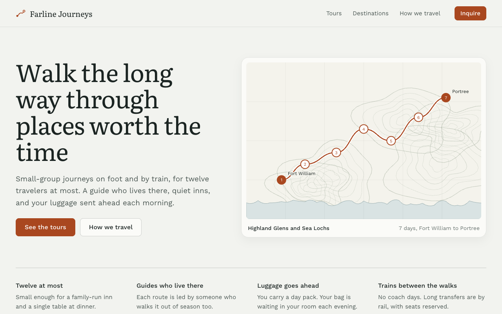

# Farline Journeys: Astro travel website template

A tour operator website for small-group trips: destinations, a tours list with filters, a page per tour with its itinerary day by day on a drawn route map, departure dates with prices and spaces, and an enquiry form. Static, fast, and no server needed.



[](https://console.cloudzyro.com/new?repo=https://github.com/Cloudzyro/template-travel)

## What's included

- Home page with a drawn topographic route map, what every journey includes, all tours and the destinations
- Tours page with filters for destination, length and month (in the browser, kept in the address so a filtered list can be shared)
- A page per tour: summary, length, level, group size, the itinerary day by day with walking distances and where you sleep, the route on a drawn map with a numbered stop for each day, dates and prices with spaces left, and what's included
- Destinations page grouping tours by place, and a How we travel page (group sizes, levels, where you stay, deposits)
- Enquiry form that picks up the tour and departure from the Enquire button you came from
- Travel agency and tour structured data (schema.org) with offers per departure, Open Graph tags, sitemap, robots.txt, favicon and a 404 page
- Responsive down to 360px, keyboard friendly, reduced motion respected
- Maps are SVG drawn in code from each tour's route points, so there are no map tiles or photos to license

## Run it locally

```bash
pnpm install
pnpm dev        # http://localhost:4321
pnpm build      # static site in dist/
pnpm preview
```

## Make it yours

- **Content:** everything is in `src/data/site.ts`: the company, destinations, and the tours. Each tour has its days, level, group size, start and end, what's included and not, the itinerary (one entry per day), departures (date, price, spaces left) and its route.
- **Maps:** each tour's `route` is one point per day in a 600 x 400 box, and `terrain` is a number that picks the shape of the hills. Change the points to change the line; change the number for different contours.
- **Enquiry form:** set `PUBLIC_FORM_ENDPOINT` to a form endpoint from Formspree, Basin, a Supabase function or similar. The form sends `tour`, `date`, `travelers`, `rooms`, `name`, `email`, `phone` and `message` as form data. With no endpoint set, the form shows a short note and opens the visitor's email app addressed to the email in `src/data/site.ts`.
- **Site address:** set `SITE_URL` (for example `https://www.farlinejourneys.com`) so the sitemap, canonical links and social previews use your domain.
- **Colors and fonts:** colors are CSS variables at the top of `src/styles/global.css`. Fonts are Literata for headlines and Work Sans for everything else, self-hosted with Fontsource and imported in `src/layouts/Base.astro`.
- **Social preview image:** replace `public/og.png` (1200 x 630).

Environment variables are read at build time. Locally, put them in `.env` (see `.env.example`):

```bash
PUBLIC_FORM_ENDPOINT=https://formspree.io/f/your-id
SITE_URL=https://www.farlinejourneys.com
```

## Deploy

Click the Deploy button above, or push your own copy to GitHub and connect it in the Cloudzyro console. Add the environment variables in your site's settings. The build command is `pnpm build` and the output folder is `dist/`, a plain static site.

## Stack

- Astro 7 (static output)
- @astrojs/sitemap
- Fontsource (Literata, Work Sans)
- TypeScript, plain CSS

MIT licensed. See [LICENSE](./LICENSE).
